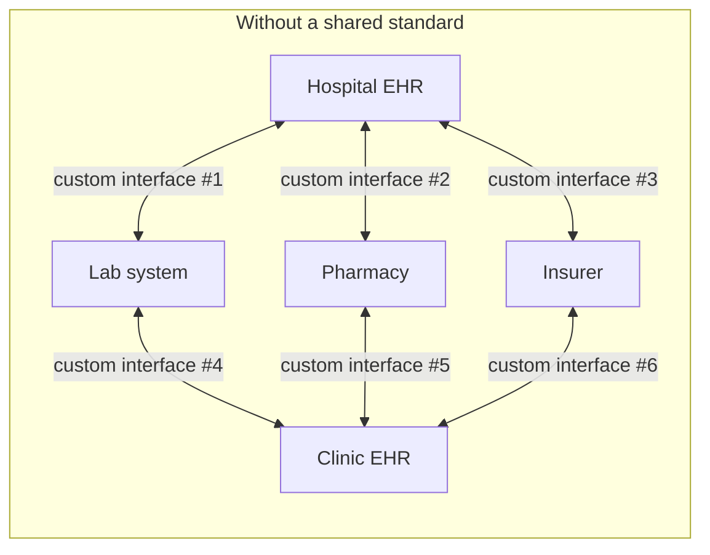
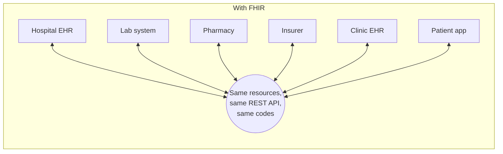
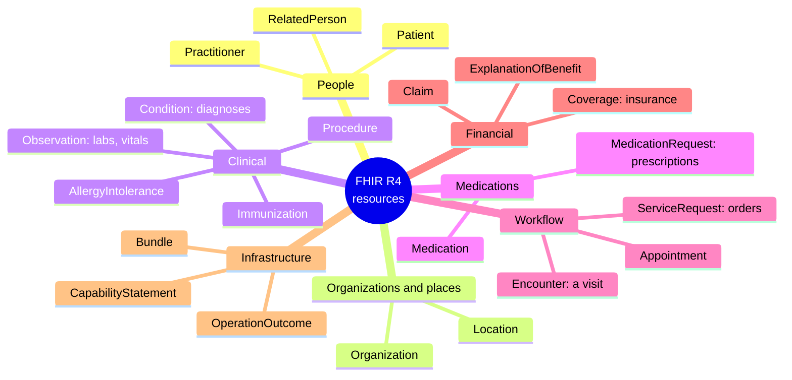
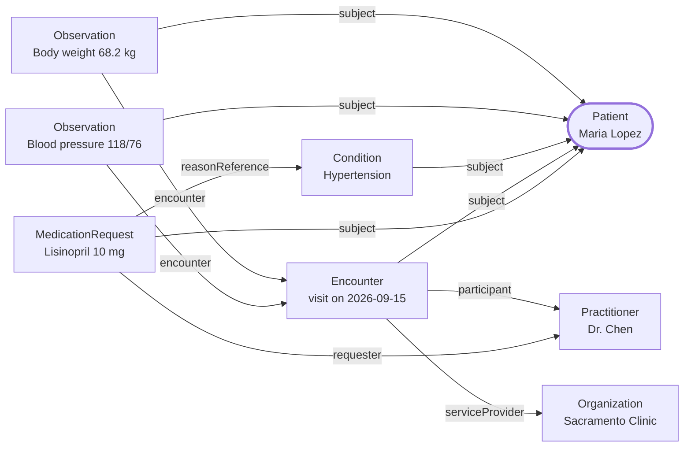
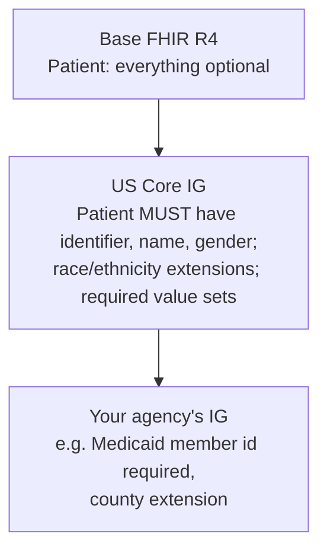

# 0a. FHIR basics: for people who have never heard of FHIR

No healthcare or FHIR background needed. If you've built or called a REST API before, you already know half of FHIR.

**FHIR** (say "fire") stands for **F**ast **H**ealthcare **I**nteroperability **R**esources. It's a standard from
the non-profit **HL7 International** for exchanging health data between systems over the web.

---

## 1. The problem FHIR solves

A patient's information is spread across many systems that were never designed to talk to each other:



Every pair of systems needs its own custom integration, with its own field names, codes and formats. With N systems
that's up to N×(N−1)/2 integrations, and each one breaks when either side changes.



Everyone agrees on **what a "Patient" or a "lab result" looks like** and **how to ask for one**. A new system
integrates once, with the standard, rather than once per partner.

### A short history

| Standard | Era | Looks like | Still used? |
|---|---|---|---|
| HL7 v2 | 1989– | `PID\|1\|\|12345^^^MRN\|\|Smith^John\|\|19800101\|M` (pipe-delimited messages) | Yes, very widely inside hospitals |
| HL7 v3 / CDA | 2005– | Large XML documents (e.g. discharge summaries) | Yes, for clinical documents |
| **FHIR** | 2014– (R4: 2019) | REST + JSON, like any modern web API | **The current standard**, and required by US regulations |

### Why it matters for government and agency work

In the US, regulations now **require** FHIR APIs:

- **ONC's Cures Act rule:** certified EHR systems must offer a standardized FHIR R4 API, with US Core data and SMART on FHIR security.
- **CMS interoperability rules:** many payers, including Medicaid and CHIP programs, must offer FHIR APIs: Patient Access,
  and under newer rules Provider Access, Payer-to-Payer and Prior Authorization.
- Public health reporting (immunizations, case reports) and data exchange networks (TEFCA) increasingly run on FHIR.

So an agency project that touches health data will very likely need to **provide** or **consume** a FHIR API.

---

## 2. The big idea: resources

Everything in FHIR is a **resource**: a small, self-contained piece of health information with a standard shape.
A resource is a JSON document (XML is also allowed) with a `resourceType` field.

FHIR R4 defines about **145 resource types**. You don't need to learn them all; most projects use 10–20.



**This repo implements:** `Patient` and `Observation` (plus `Bundle`, `OperationOutcome` and `CapabilityStatement`,
which every server needs).

### Anatomy of a resource

Here's a real Patient from this repo's sample data, with notes:

```jsonc
{
  "resourceType": "Patient",                      // which kind of resource
  "id": "5f2a7c1e-3b64-4c9a-9f4e-1a2b3c4d5e01",   // assigned by the server; part of the URL
  "meta": {                                       // managed by the server
    "versionId": "1",                             //   bumps on every update
    "lastUpdated": "2026-11-01T23:52:10Z"
  },
  "identifier": [{                                // business ids (MRN, SSN, member id...). A patient can have many.
    "system": "http://example.org/fhir/mrn",      //   WHO issued it (a URI namespace)
    "value": "MRN-1001"                           //   the id itself
  }],
  "name": [{                                      // a list: people have legal names, maiden names, nicknames...
    "use": "official",
    "family": "Lopez",
    "given": ["Maria", "Elena"],
    "prefix": ["Ms."]
  }],
  "gender": "female",                             // a code from a fixed list: male | female | other | unknown
  "birthDate": "1984-03-12"                       // FHIR dates can be partial: "1984" or "1984-03" are valid too
}
```

Notice:

- **Almost everything is optional and repeatable.** Real-world data is messy: unknown birth dates, several names,
  several ids. FHIR models that rather than forcing one value.
- **`id` vs `identifier`:** `id` is the server's technical key (in the URL). `identifier` holds the real-world ids that
  other systems know the person by.

### Data types: the building blocks inside resources

Resources are made of reusable data types:

| Type | Example | Used for |
|---|---|---|
| Primitives | `"2026-09-15"`, `true`, `68.2`, `"final"` | string, boolean, decimal, date, dateTime, code... |
| `HumanName` | `{"family": "Lopez", "given": ["Maria"]}` | names |
| `Identifier` | `{"system": "...mrn", "value": "MRN-1001"}` | business ids |
| `CodeableConcept` | `{"coding": [{"system": "http://loinc.org", "code": "29463-7"}], "text": "Body weight"}` | coded values (see Terminology) |
| `Quantity` | `{"value": 68.2, "unit": "kg", "system": "http://unitsofmeasure.org", "code": "kg"}` | measurements with units |
| `Reference` | `{"reference": "Patient/123"}` | a link to another resource |
| `Period` | `{"start": "2026-09-15T09:00:00Z", "end": "..."}` | time ranges |

**Choice types:** some fields accept several types, and the type becomes part of the field name. `Observation.value[x]`
appears in JSON as `valueQuantity`, `valueString`, `valueBoolean`, etc. `effective[x]` appears as `effectiveDateTime`
or `effectivePeriod`.

---

## 3. References: how resources connect

Resources are small and link to each other with **references**, like foreign keys or hyperlinks.
Here's one clinic visit expressed as FHIR resources:



Every clinical resource points to the **Patient** through `subject`. That's what makes "give me everything about
this patient" possible (the *patient compartment*).

In JSON a reference is just a string: `"subject": {"reference": "Patient/5f2a7c1e-..."}`.
Clients follow references with more requests, or ask the server to include them in one response (`_include`).

**In this repo:** an `Observation.subject` must point to a Patient that exists, otherwise the server returns 400
(see `ResourceRepository.ValidateAsync`).

---

## 4. Terminology: codes instead of free text

"Blood sugar", "glucose", "GLU" and "Glucose [Mass/volume] in Blood" can all mean the same test. Computers need one
unambiguous code, so FHIR uses standard **code systems**:

| Code system | Used for | Example |
|---|---|---|
| **LOINC** (`http://loinc.org`) | lab tests, vital signs, survey questions | `4548-4` = Hemoglobin A1c |
| **SNOMED CT** (`http://snomed.info/sct`) | diagnoses, findings, procedures | `38341003` = Hypertension |
| **RxNorm** (`http://www.nlm.nih.gov/research/umls/rxnorm`) | medications (US) | `314076` = Lisinopril 10 MG Oral Tablet |
| **ICD-10-CM** (`http://hl7.org/fhir/sid/icd-10-cm`) | diagnoses for billing (US) | `I10` = Essential hypertension |
| **UCUM** (`http://unitsofmeasure.org`) | units | `mg/dL`, `kg`, `mm[Hg]` |
| FHIR's own value sets | small fixed lists | `gender`: male / female / other / unknown |

A code is always a **system + code** pair. `4548-4` alone could mean anything; `http://loinc.org|4548-4` is
unambiguous. That's why token search in this repo accepts `code=http://loinc.org|4548-4`.

```json
"code": {
  "coding": [
    { "system": "http://loinc.org", "code": "4548-4", "display": "Hemoglobin A1c/Hemoglobin.total in Blood" }
  ],
  "text": "HbA1c"
}
```

A `CodeableConcept` can carry **several codings** for the same idea (e.g. a SNOMED code and an ICD-10 code), plus the
original free text.

---

## 5. The REST API

FHIR uses ordinary HTTP. If you know REST, you know this:

| You want to... | HTTP | FHIR name | Response |
|---|---|---|---|
| See what the server supports | `GET /metadata` | capabilities | CapabilityStatement |
| Create | `POST /Patient` + JSON | create | 201 + `Location` header |
| Read | `GET /Patient/123` | read | 200 + Patient |
| Update (replace) | `PUT /Patient/123` + JSON | update | 200 (or 201 if new) |
| Delete | `DELETE /Patient/123` | delete | 204 |
| See all versions | `GET /Patient/123/_history` | history | Bundle |
| Read an old version | `GET /Patient/123/_history/2` | vread | Patient as it was |
| Search | `GET /Patient?family=lopez` | search | Bundle of matches |
| Run an operation | `POST /Patient/123/$everything` | operation | depends (not in this repo) |

FHIR-specific conventions on top of plain REST:

- **Content type:** `application/fhir+json`.
- **Versioning:** every change creates a new version. `ETag: W/"3"` tells you the version, and sending
  `If-Match: W/"3"` with an update means "only if nobody changed it since I read it" (otherwise 412).
- **Errors** are always an `OperationOutcome` resource, never plain text.

---

## 6. Search

Search uses query parameters, but each parameter has a **type** that decides how matching works:

| Type | Example | How it matches |
|---|---|---|
| string | `name=mar` | case-insensitive "starts with" |
| token | `gender=female`, `code=http://loinc.org\|4548-4` | exact code, optionally with system |
| date | `birthdate=ge1980-01-01` | ranges, with prefixes `eq ne gt lt ge le` |
| reference | `subject=Patient/123` | link to a specific resource |
| number, quantity, uri, composite | `value-quantity=gt7\|\|%` | (not implemented here) |

Combining: `a=1&b=2` means **AND**; `a=1,2` means **OR**. Results come back in a **Bundle**.

---

## 7. Bundles: containers of resources

A `Bundle` holds many resources. Its `type` says what it's for:

| Bundle type | Used for | In this repo |
|---|---|---|
| `searchset` | search results, with paging links | ✔ |
| `history` | versions of a resource | ✔ |
| `transaction` | many writes that all succeed or all fail | sample data uses this format (imported, not served) |
| `batch` | many independent requests in one HTTP call | ✘ |
| `document` | a signed clinical document (e.g. discharge summary) | ✘ |
| `collection`, `message` | other exchange patterns | ✘ |

```text
Bundle (type = searchset, total = 2)
├── link   next → /Observation?code=...&_offset=20
├── entry  Observation/abc   (search.mode = match)
├── entry  Observation/def   (search.mode = match)
└── entry  Patient/123       (search.mode = include)
```

---

## 8. Profiles and Implementation Guides: base FHIR is deliberately loose

Base FHIR makes almost everything optional so it works for every country and use case. Real projects then
**constrain** it:



- A **profile** (a `StructureDefinition`) is a set of rules on a resource: "this field is required", "this code must
  come from that list", "this extension is allowed".
- An **Implementation Guide (IG)** is a published package of profiles, search requirements and examples for one
  purpose. **US Core** is the most important IG in the US; payer APIs use the **CARIN Blue Button** and **Da Vinci** IGs.
- **Extensions** add data the base spec lacks (e.g. US Core race and ethnicity). Every element can carry extensions,
  which is one reason FHIR data is stored as JSON documents rather than fixed tables.

**This repo** validates only base FHIR rules. Profile validation (e.g. against US Core) is listed as a next step in the README.

---

## 9. Versions of FHIR

| Version | Year | Notes |
|---|---|---|
| DSTU2 | 2015 | old; still found in legacy systems |
| STU3 | 2017 | some older implementations |
| **R4 (4.0.1)** | 2019 | **The one to use.** First release with "normative" (stable) parts, including Patient and Observation. Required by US regulations. |
| R4B | 2022 | small update to R4 |
| R5 | 2023 | newest; adoption is slow; most regulations still point to R4 |

Versions aren't wire-compatible, so a server states its version in `/metadata` (`fhirVersion: 4.0.1`).
This repo uses the `Hl7.Fhir.R4` package.

---

## 10. Concept map: from FHIR idea to file in this repo

| FHIR concept | Where to see it |
|---|---|
| Resource types we serve | [`Fhir/SupportedResources.cs`](../src/MyFhirApi.Api/Fhir/SupportedResources.cs) |
| Resource classes (Patient, Observation...) | Firely SDK: `Hl7.Fhir.Model` namespace |
| REST interactions | [`Controllers/FhirController.cs`](../src/MyFhirApi.Api/Controllers/FhirController.cs) |
| Versioning, history, ETag | [`Data/ResourceRepository.cs`](../src/MyFhirApi.Api/Data/ResourceRepository.cs) |
| Search parameter types | [`Search/`](../src/MyFhirApi.Api/Search) and [Search engine](05-search-engine.md) |
| Bundles | [`Search/BundleBuilder.cs`](../src/MyFhirApi.Api/Search/BundleBuilder.cs) |
| CapabilityStatement | [`Controllers/MetadataController.cs`](../src/MyFhirApi.Api/Controllers/MetadataController.cs) |
| OperationOutcome | [`Fhir/FhirException.cs`](../src/MyFhirApi.Api/Fhir/FhirException.cs) |
| Terminology in practice | [`SampleData/synthetic-patients.json`](../src/MyFhirApi.Api/SampleData/synthetic-patients.json) (LOINC codes) |

---

## Glossary

| Term | Meaning |
|---|---|
| **HL7** | Health Level Seven International, the organization that publishes FHIR |
| **EHR / EMR** | Electronic Health Record system used by hospitals and clinics (Epic, Oracle Health, ...) |
| **PHI** | Protected Health Information. Health data tied to a person; protected by HIPAA in the US |
| **Resource** | A unit of FHIR data with a standard shape (Patient, Observation...) |
| **Element** | A field inside a resource (`Patient.birthDate`) |
| **Reference** | A link from one resource to another (`Patient/123`) |
| **Code system** | A list of codes with meanings (LOINC, SNOMED CT) |
| **Value set** | A selection of codes allowed in a particular field |
| **CodeableConcept** | A field holding one or more codes plus text |
| **Bundle** | A container of resources |
| **CapabilityStatement** | A server's description of what it supports (`/metadata`) |
| **OperationOutcome** | A resource describing errors and warnings |
| **Profile** | Rules that constrain a resource for a use case |
| **Implementation Guide (IG)** | A published set of profiles and rules (e.g. US Core) |
| **Extension** | Extra data added to a resource beyond the base spec |
| **Compartment** | All resources related to one subject, e.g. everything about one patient |
| **FHIRPath** | A small query language for navigating resources, e.g. `Patient.name.family` |
| **Synthea** | An open-source generator of realistic fake patients |
| **US Core** | The baseline US Implementation Guide, required by ONC certification |

## Where to learn more

- The spec, very readable: https://hl7.org/fhir/R4/ (start with "Overview" and the Patient page)
- US Core: https://hl7.org/fhir/us/core/
- Try a public test server: `GET https://hapi.fhir.org/baseR4/Patient?_count=5` (public data; don't send anything real)
- Firely .NET SDK docs: https://docs.fire.ly/projects/Firely-NET-SDK/
- Synthea synthetic data: https://synthea.mitre.org

Next: [SMART on FHIR basics](00-smart-basics.md), the security side.
