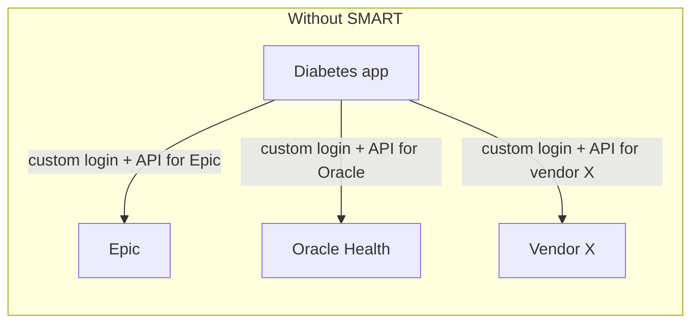
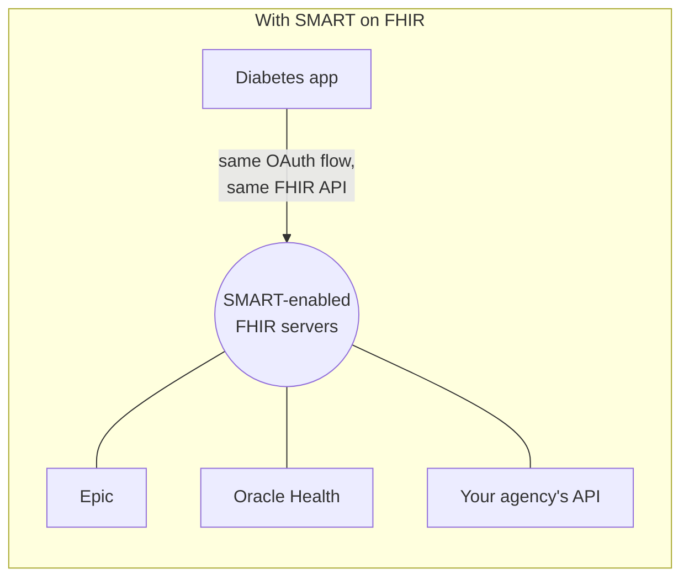
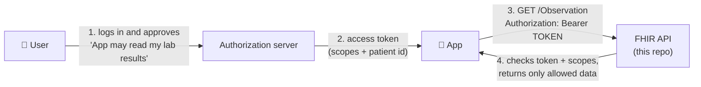
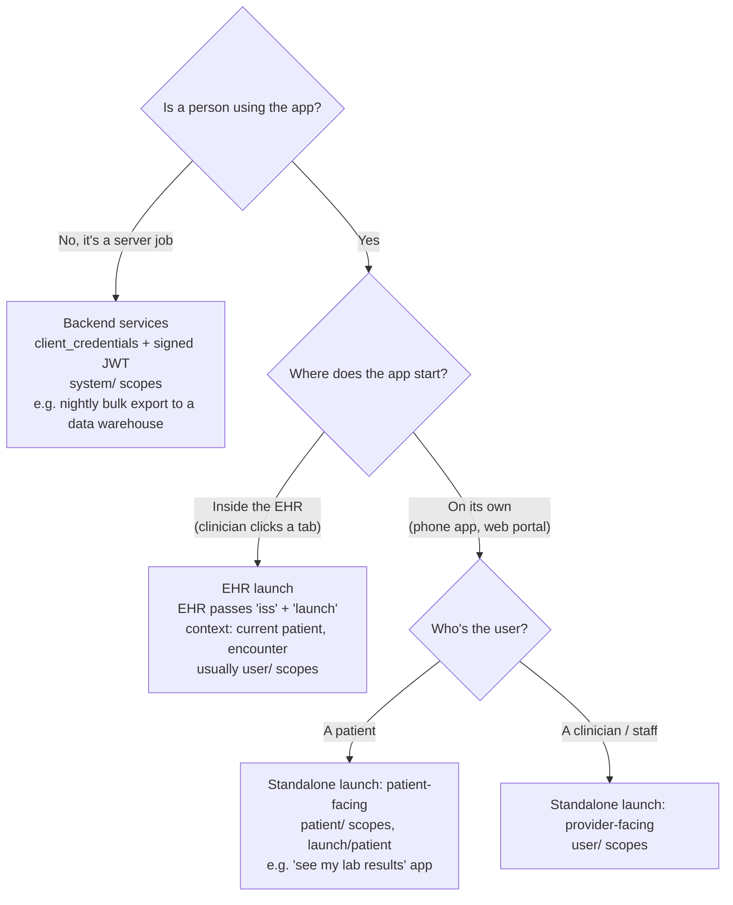
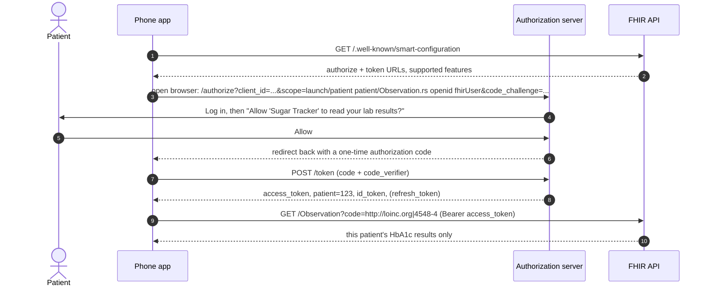
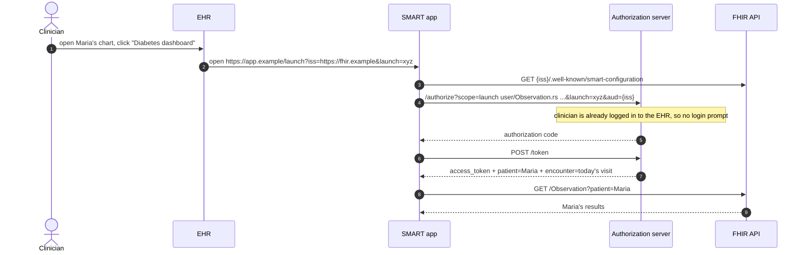
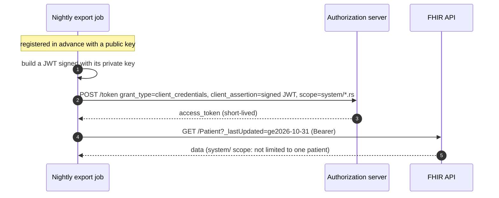
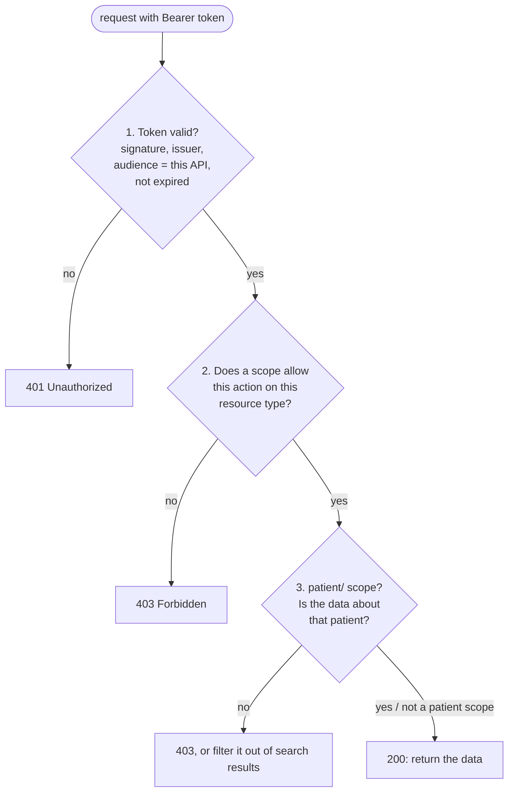

# 0b. SMART on FHIR basics: for people new to OAuth and SMART

Read [FHIR basics](00-fhir-basics.md) first. This page explains how a FHIR API decides **who may see which data**.

**SMART on FHIR** (**S**ubstitutable **M**edical **A**pplications, **R**eusable **T**echnologies) is a standard
security layer for FHIR APIs. It was created at Boston Children's Hospital and Harvard and is now published by HL7.
Under the hood it's **OAuth 2.0** and **OpenID Connect**, the same technology behind "Sign in with Google", plus a few
healthcare-specific rules.

---

## 1. The problem SMART solves

Without SMART, every app needs a custom integration and custom login for every EHR:



With SMART, an app is written **once** and works with any EHR or FHIR server that supports the standard.
That's the "substitutable" part:



It also answers the security questions every health API faces:

- **Who is the user?** (a patient, a nurse, a billing clerk, a backend job)
- **Which app** is acting for them?
- **What may the app do**: read only? Only lab results?
- **Whose data**: only this one patient, or everyone the user can see?

---

## 2. OAuth 2.0 in plain words: the valet key

You hand a parking valet a **valet key**: it starts the car but doesn't open the trunk or glovebox, and it only works
tonight. You never hand over your house keys.

OAuth works the same way:

| Valet analogy | OAuth term | In SMART on FHIR |
|---|---|---|
| You, the car owner | **Resource owner / user** | The patient or clinician |
| The valet | **Client** | The app (patient portal, mobile app, backend job) |
| The key cabinet at the front desk | **Authorization server** | Login + consent service (Epic, Okta, Keycloak, Entra ID) |
| The valet key | **Access token** | A short-lived JWT the app sends with each request |
| What the key opens | **Scopes** | `patient/Observation.rs` = read and search this patient's Observations |
| The car | **Resource server** | **The FHIR API, i.e. this repo** |

The app **never sees the user's password**. The user logs in at the authorization server, approves what the app asked
for, and the app receives a token that can do only that.



---

## 3. What's inside an access token

SMART tokens are usually **JWTs** (JSON Web Tokens): three Base64 parts, `header.payload.signature`.
Paste a token into https://jwt.io to decode it (only test tokens, never real ones). The payload of a patient-app token:

```jsonc
{
  "iss": "https://auth.example.org",         // issuer: which authorization server created it
  "aud": "https://fhir.example.org",         // audience: which API it's for. The API must check this!
  "sub": "user-8812",                        // subject: who logged in
  "exp": 1793577600,                         // expiry (Unix time). Usually minutes to an hour away.
  "scope": "openid fhirUser launch/patient patient/Observation.rs patient/Patient.r",
  "patient": "5f2a7c1e-3b64-4c9a-9f4e-1a2b3c4d5e02",   // launch context: which patient (see note)
  "fhirUser": "Patient/5f2a7c1e-3b64-4c9a-9f4e-1a2b3c4d5e02"
}
```

The **signature** proves the authorization server issued it and nobody changed it. The API checks it with the
server's public key (or, locally, the `dotnet user-jwts` key).

> **Note on `patient`:** the SMART spec returns the patient id in the **token response** next to the access token.
> Whether it's also a claim **inside** the token depends on the authorization server. This prototype reads a `patient`
> claim from the token. That's a common setup, but check what your authorization server actually does.

---

## 4. Scopes: what the token allows

```text
 patient / Observation . rs
 ───┬───   ─────┬─────   ─┬
    │           │         └─ what:  c=create  r=read  u=update  d=delete  s=search
    │           └─ which resource type (* = all)
    └─ whose data:
         patient/  only the one patient in the launch context
         user/     whatever this user is allowed to see (e.g. a clinician's patients)
         system/   a backend service with no user (e.g. a nightly export job)
```

| Scope | Plain English |
|---|---|
| `patient/Observation.rs` | Read and search **this patient's** lab results and vitals |
| `patient/*.rs` | Read and search **everything about this patient** |
| `user/Patient.cruds` | Full access to the Patients **this user** can access |
| `system/*.rs` | A backend job may read anything (typical for bulk export) |
| `openid fhirUser` | Also tell the app **who** logged in (OpenID Connect) |
| `launch/patient` | "Let the user pick a patient", so a `patient` context is returned |
| `offline_access` | Give a refresh token so the app keeps access after the user leaves |

**SMART v1 vs v2:** v1 used `.read` / `.write` / `.*`. v2 (2021) uses the letters `c r u d s`.
`patient/Observation.read` (v1) ≈ `patient/Observation.rs` (v2). This repo accepts both.

**Least privilege:** apps should ask only for what they need. A blood-pressure tracker asks for
`patient/Observation.rs`, not `user/*.cruds`.

---

## 5. The four ways apps connect



### Standalone launch: a patient's phone app



**PKCE** (`code_challenge` / `code_verifier`) stops a stolen authorization code from being used by anyone else.
It's required for apps that can't keep a secret, such as phone apps and single-page web apps.

### EHR launch: an app embedded in a clinician's EHR



The `launch` parameter carries the **context** (the patient and visit open in the EHR), so the clinician doesn't have
to search for the patient again.

### Backend services: no user at all



Used for data warehouses, public health reporting and **Bulk Data** export (`$export`). There's no consent screen, so
these clients are vetted and registered by an administrator.

---

## 6. Discovery: how an app finds the login URLs

An app that only knows the FHIR server's base URL can find everything else:

| Endpoint | Returns | In this repo |
|---|---|---|
| `GET /.well-known/smart-configuration` | JSON: `authorization_endpoint`, `token_endpoint`, `scopes_supported`, `capabilities` | [`SmartConfigController.cs`](../src/MyFhirApi.Api/Controllers/SmartConfigController.cs) |
| `GET /metadata` | CapabilityStatement; `rest.security` says "SMART-on-FHIR" and lists the OAuth URLs | [`MetadataController.cs`](../src/MyFhirApi.Api/Controllers/MetadataController.cs) |

Both are **public** (no token needed): apps call them before they have a token.

---

## 7. What the FHIR API itself must do

The authorization server handles logins and consent. **The FHIR API is responsible for enforcement:**



| Step | In this repo |
|---|---|
| 1. Validate the token | ASP.NET Core `JwtBearer` (configured in `Program.cs`) |
| 2. Check scopes | [`SmartScope.cs`](../src/MyFhirApi.Api/Auth/SmartScope.cs), [`SmartAccessService.cs`](../src/MyFhirApi.Api/Auth/SmartAccessService.cs) |
| 3. Patient compartment | [`PatientCompartment.cs`](../src/MyFhirApi.Api/Auth/PatientCompartment.cs) |

The full flow with diagrams is in [Security (SMART on FHIR)](06-security-smart.md).

### Security habits worth keeping

- **Always check `aud`.** Otherwise a token issued for another API could be replayed against yours.
- **Short-lived access tokens** (minutes); use refresh tokens for long sessions.
- **Never log tokens or put them in URLs.** They're as sensitive as passwords.
- **Return 403 or filter, never "empty but successful" for denied reads.** Clients must be able to tell "no data" from "not allowed".
- **Audit every access** to PHI (who, what, when). FHIR has an `AuditEvent` resource for this, and HIPAA expects it.
- **HTTPS only** in every environment except your own machine.

---

## 8. Trying it in this repo

Locally there's no real authorization server. `dotnet user-jwts` creates signed test tokens instead:

```bash
# a patient app for James Nguyen (sample patient)
dotnet user-jwts create --project src/MyFhirApi.Api --scope "patient/*.rs" \
    --claim "patient=5f2a7c1e-3b64-4c9a-9f4e-1a2b3c4d5e02" --output token

# run the API with access checks on
dotnet run --project src/MyFhirApi.Api -- --Smart:Enabled=true
```

Then call `GET http://localhost:5025/Observation` with `Authorization: Bearer <token>`. You get only James's 3
Observations, even though the request didn't ask for any patient. Try the same with `user/*.cruds` and `user/Patient.read`
tokens and compare (see the table in [Security](06-security-smart.md#outcomes-with-real-tokens)).

---

## Glossary

| Term | Meaning |
|---|---|
| **OAuth 2.0** | Standard for granting an app limited access without sharing passwords |
| **OpenID Connect (OIDC)** | Layer on OAuth that also tells the app **who** the user is (`id_token`) |
| **Authorization server** | Issues tokens after login and consent (Okta, Keycloak, Entra ID, the EHR's own) |
| **Resource server** | The API that holds the data and checks tokens. Here, the FHIR API. |
| **Client** | The app requesting access |
| **Access token** | Short-lived credential sent as `Authorization: Bearer ...` |
| **Refresh token** | Longer-lived credential used to get new access tokens |
| **JWT** | JSON Web Token: a signed JSON payload, the usual access token format |
| **Scope** | A permission string, e.g. `patient/Observation.rs` |
| **Claim** | A field inside a JWT (`sub`, `aud`, `scope`, `patient`) |
| **Launch context** | Extra info passed with the token: which patient, which encounter |
| **PKCE** | Proof Key for Code Exchange; protects the authorization code in public apps |
| **Public vs confidential client** | Can't keep a secret (phone app) vs can (server-side app) |
| **Standalone / EHR launch** | App starts on its own vs from inside an EHR |
| **Backend services** | Server-to-server access with `system/` scopes, no user |
| **`fhirUser`** | Claim pointing to the FHIR resource for the logged-in user (`Patient/123`, `Practitioner/9`) |
| **Patient compartment** | All resources about one patient; what `patient/` scopes are limited to |

## Where to learn more

- SMART App Launch spec: https://hl7.org/fhir/smart-app-launch/
- Scopes and launch context: https://hl7.org/fhir/smart-app-launch/scopes-and-launch-context.html
- Backend services: https://hl7.org/fhir/smart-app-launch/backend-services.html
- SMART launcher sandbox (try flows without an EHR): https://launch.smarthealthit.org
- OAuth 2.0 simplified: https://www.oauth.com
