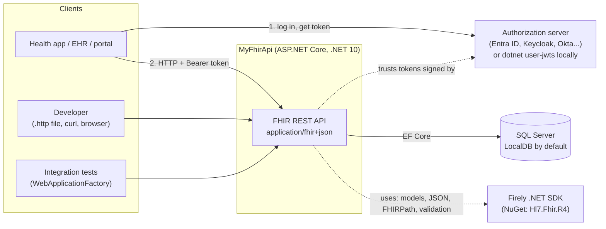
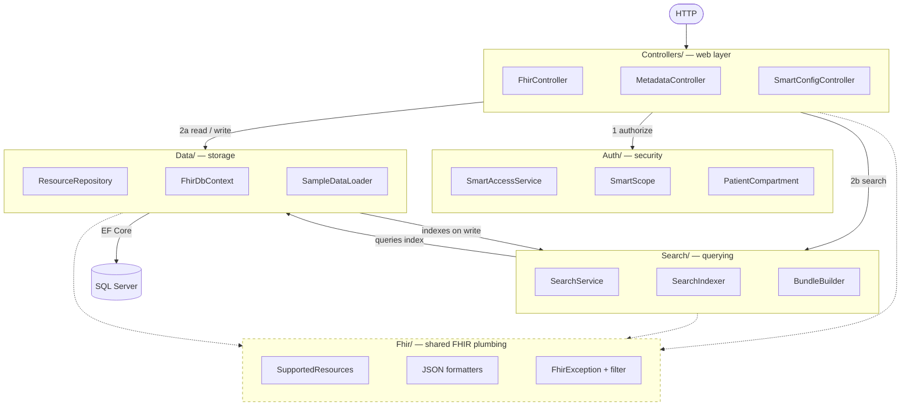
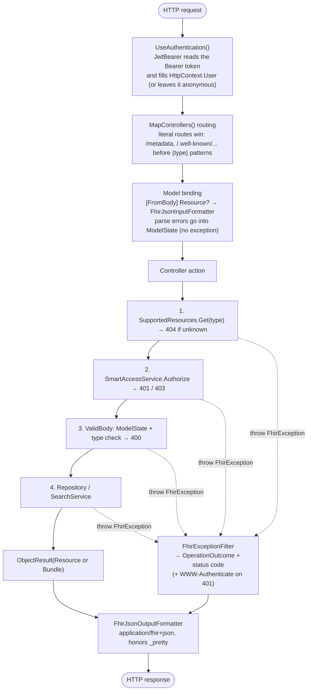
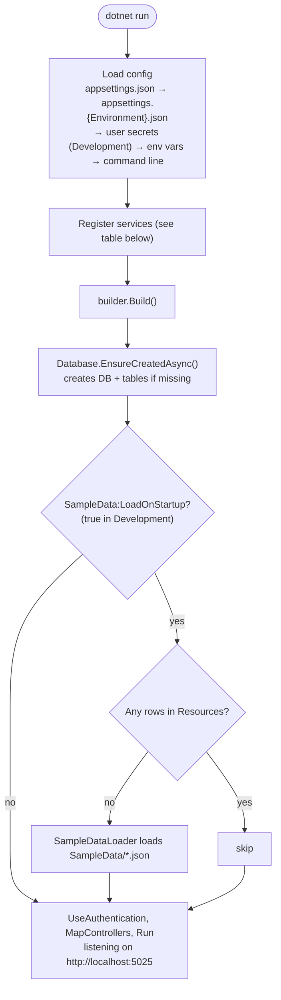
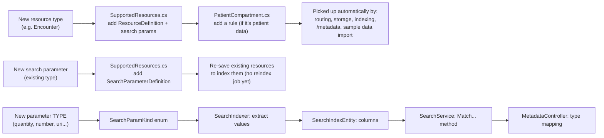

# 1. Architecture

## System context

Who talks to the API, and what the API depends on.

The API never issues tokens. It only **validates** them. In production an authorization server issues them;
locally, `dotnet user-jwts` plays that role.

## Layers

Each folder is one layer. Arrows show "calls / depends on". The dotted box, `Fhir/`, is shared plumbing that
every layer uses. (Class-level dependencies are in [Class diagrams](03-class-diagrams.md).)

| Folder | Responsibility | Knows about HTTP? | Knows about SQL? |
|---|---|---|---|
| `Controllers/` | Map FHIR URLs to operations; set FHIR headers (ETag, Location, Last-Modified) | Yes | No |
| `Fhir/` | FHIR JSON in and out, errors as OperationOutcome, the list of supported types | Yes (formatters, filter) | No |
| `Auth/` | Decide whether a token may do something | Only via `ClaimsPrincipal` | No |
| `Search/` | Index values and turn search parameters into queries | No (`SearchRequest` reads the query collection) | Through EF LINQ |
| `Data/` | Versioned storage and transactions | No | Yes (EF Core) |

**Design choice: one generic controller.** FHIR uses the same URL patterns for every resource type, so
`FhirController` takes `{type}` as a route value and looks it up in `SupportedResources`. Adding a resource type
doesn't add a controller.

## ASP.NET Core request pipeline

What happens to every HTTP request, in order.

Two things to notice:

- **Authorization runs before body validation** (step 2 before 3). A caller without permission gets 401/403 and
  learns nothing from validation messages. The formatter records parse errors instead of throwing, so this order holds.
- **Every error is an OperationOutcome.** Code anywhere throws `FhirException`, and one filter converts it.
  Unexpected exceptions become a 500 OperationOutcome and are logged.

## Startup

## Dependency injection

Registered in [`Program.cs`](../src/MyFhirApi.Api/Program.cs).

| Service | Lifetime | Why that lifetime |
|---|---|---|
| `FhirDbContext` | Scoped (per request) | EF Core contexts aren't thread-safe; one per request |
| `ResourceRepository` | Scoped | Uses the scoped `FhirDbContext` |
| `SearchService` | Scoped | Uses the scoped `FhirDbContext` |
| `SampleDataLoader` | Scoped | Uses the repository; only resolved at startup |
| `SmartAccessService` | Singleton | Stateless; reads `IOptions<SmartOptions>` |
| `TimeProvider` | Singleton (`TimeProvider.System`) | Tests could swap in a fake clock |
| `SmartOptions` | Options (`Smart` config section) | `Enabled`, `AuthorizeEndpoint`, `TokenEndpoint` |
| JwtBearer | Authentication handler | Reads `Authentication:Schemes:Bearer`; `MapInboundClaims = false` keeps `scope` and `patient` claim names |

Static helpers (`SupportedResources`, `SearchIndexer`, `BundleBuilder`, `FhirJson`, `PatientCompartment`) don't go
through DI: they're pure functions with no state.

## Configuration

| Key | Default (`appsettings.json`) | Development | Used by |
|---|---|---|---|
| `ConnectionStrings:Fhir` | LocalDB, database `MyFhirApi` | same | `FhirDbContext` |
| `Smart:Enabled` | `true` | `false` | `SmartAccessService` |
| `Smart:AuthorizeEndpoint` / `TokenEndpoint` | `https://example.org/...` | same | `/metadata`, SMART discovery |
| `SampleData:LoadOnStartup` | `false` | `true` | `Program.cs` |
| `Authentication:Schemes:Bearer:*` | not set | `dotnet-user-jwts` issuer and audiences | JwtBearer |

Override any key on the command line, e.g. `dotnet run --project src/MyFhirApi.Api -- --Smart:Enabled=true`.

## Extension points

