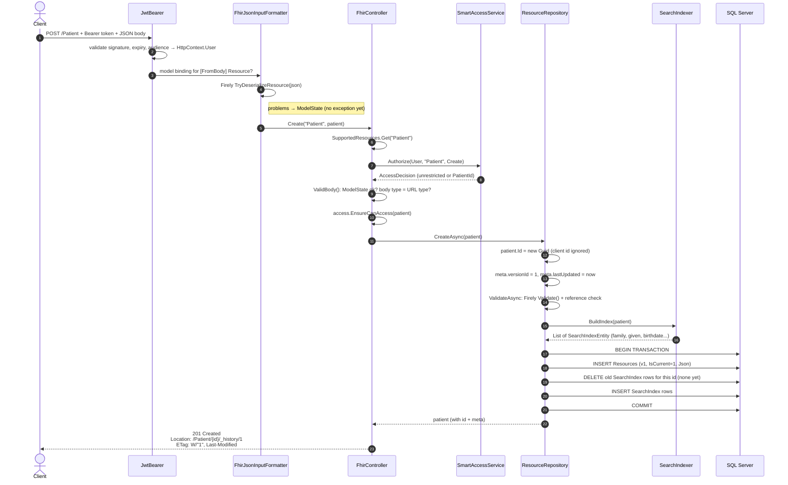
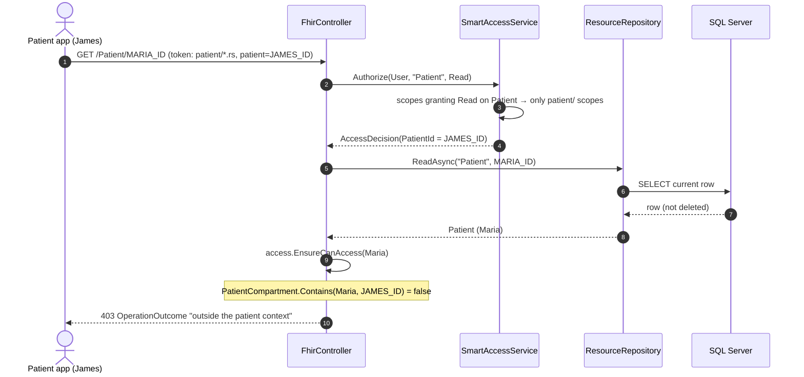
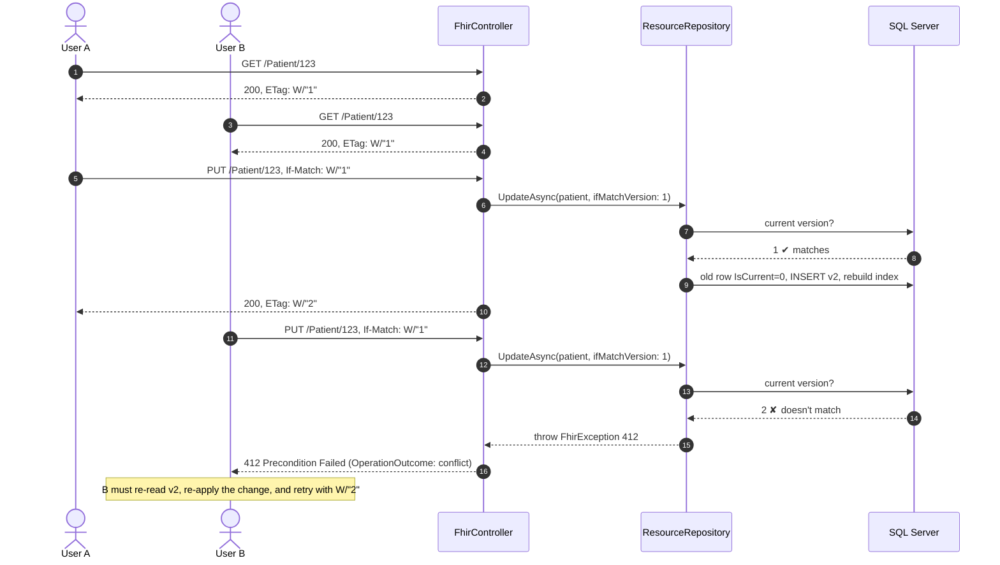
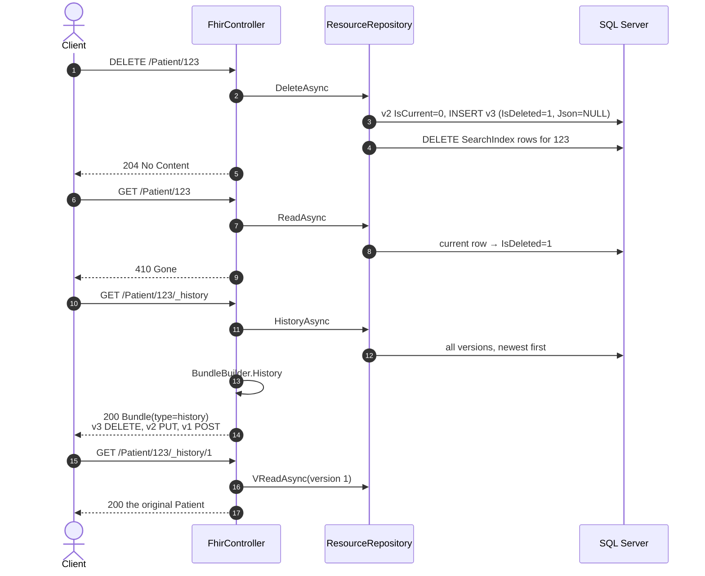
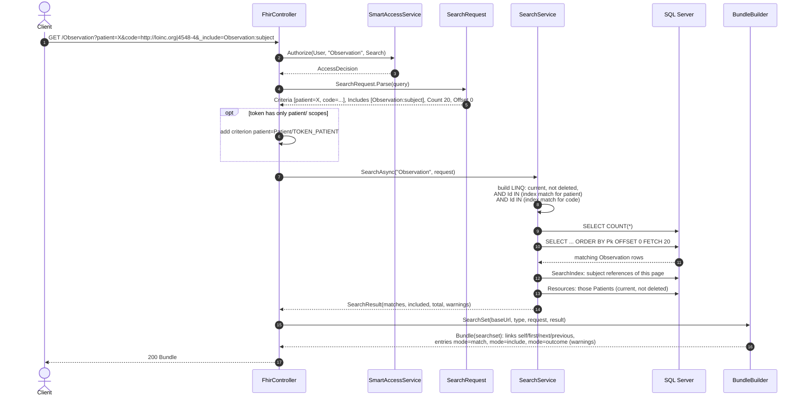
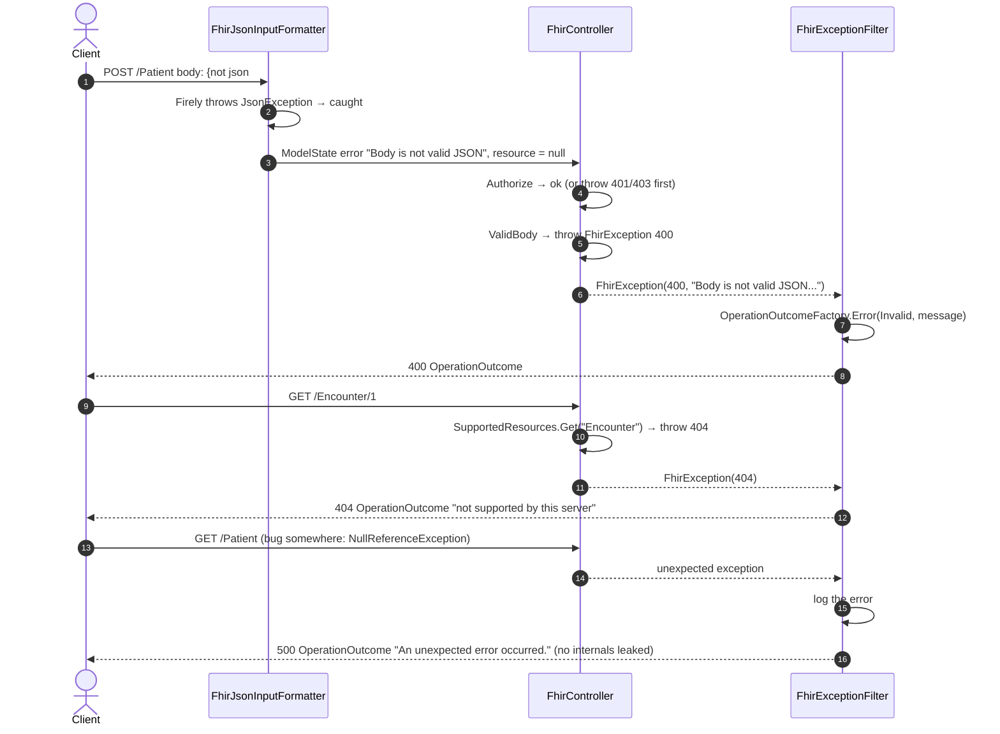
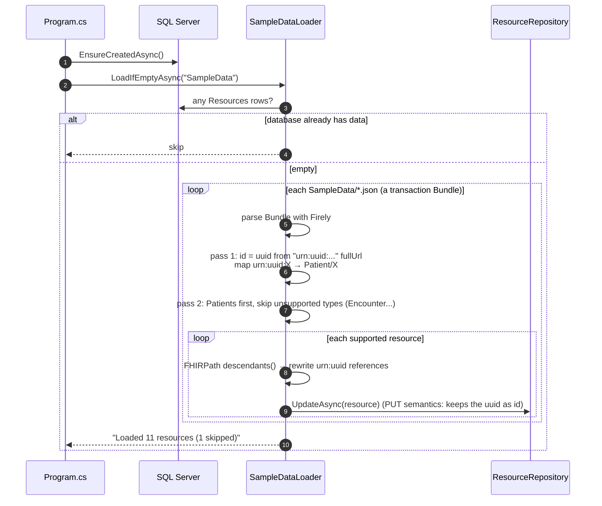
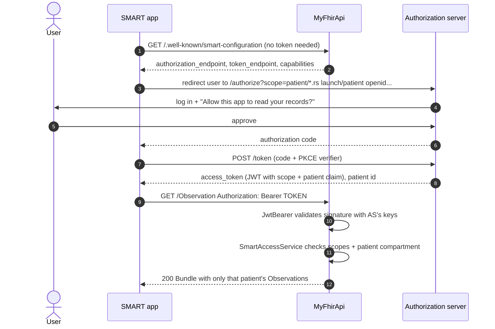

# 2. Request flows (sequence diagrams)

These follow the real call order in the code. Participants:

| Short name | Class |
|---|---|
| Client | any HTTP client |
| JwtBearer | ASP.NET Core authentication middleware |
| Formatter | `FhirJsonInputFormatter` / `FhirJsonOutputFormatter` |
| Controller | `FhirController` |
| Smart | `SmartAccessService` |
| Repo | `ResourceRepository` |
| Indexer | `SearchIndexer` |
| Search | `SearchService` |
| DB | `FhirDbContext` → SQL Server |

---

## Create a Patient — `POST /Patient`

---

## Read with a patient-scoped token — `GET /Patient/{id}`

A patient-facing app holds a token with `patient/*.rs` and `"patient": "JAMES_ID"`.

Reads check the compartment **after** loading, because you only know who a resource belongs to once you have it.
Searches narrow the query **before** running it (see below).

---

## Update with optimistic locking — `PUT /Patient/{id}` + `If-Match`

Two users edit the same patient. The second save is rejected instead of silently overwriting the first.

Without `If-Match` the update always succeeds ("last write wins").
A `PUT` to an id that doesn't exist yet **creates** it (201). FHIR calls this "update as create".

---

## Delete, history and vread

Deleting a deleted resource is a no-op that still returns 204, so `DELETE` is idempotent.

---

## Search with `_include` — `GET /Observation?patient=X&code=...&_include=Observation:subject`

Details of the matching logic are in [Search engine](05-search-engine.md).

---

## Error paths

How each failure becomes a response. Every error body is an `OperationOutcome`.

| Status | Thrown by | Example cause |
|---|---|---|
| 400 | `ValidBody`, `ResourceRepository.ValidateAsync`, `SearchService` | Bad JSON, invalid FHIR, unknown Observation subject, bad date in search |
| 401 | `SmartAccessService` | Access checks on and no valid token |
| 403 | `SmartAccessService`, `AccessDecision.EnsureCanAccess` | Missing scope, or outside the patient compartment |
| 404 | `SupportedResources.Get`, repository | Unknown resource type or id |
| 410 | `ResourceRepository.ReadAsync` | Resource was deleted |
| 412 | `ResourceRepository.UpdateAsync` | `If-Match` version isn't current |
| 500 | `FhirExceptionFilter` | Any unexpected exception |

---

## Startup and sample data loading

---

## SMART on FHIR: how an app gets and uses a token

The OAuth2 part happens between the app and the authorization server. This API only joins at the last step.

Locally, `dotnet user-jwts create --scope ... --claim patient=...` skips steps 3–8 and hands you a token directly.
