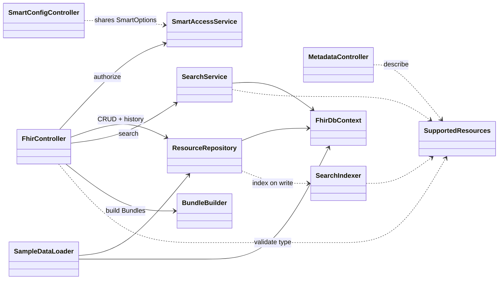
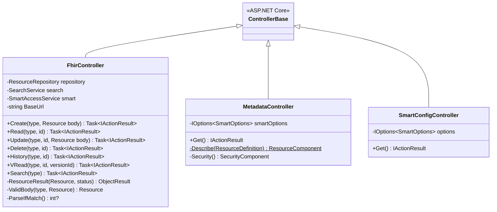
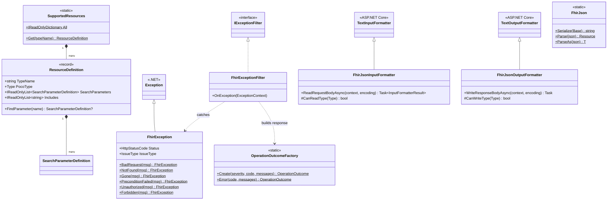
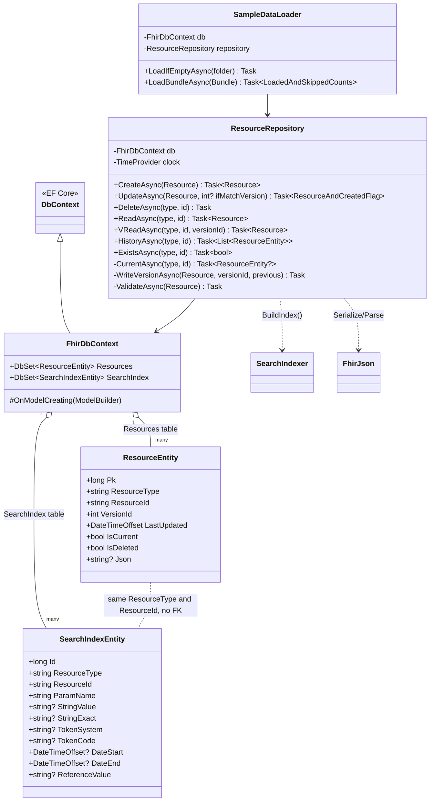
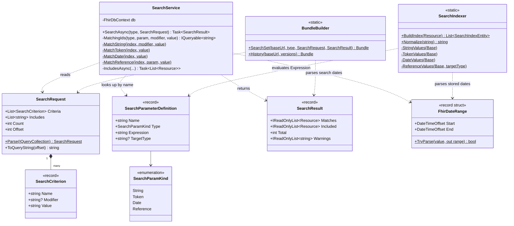
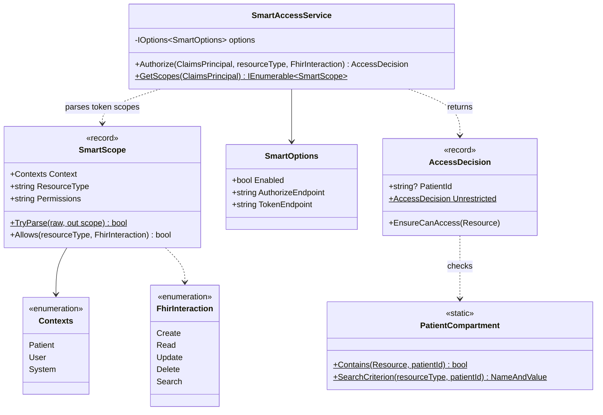
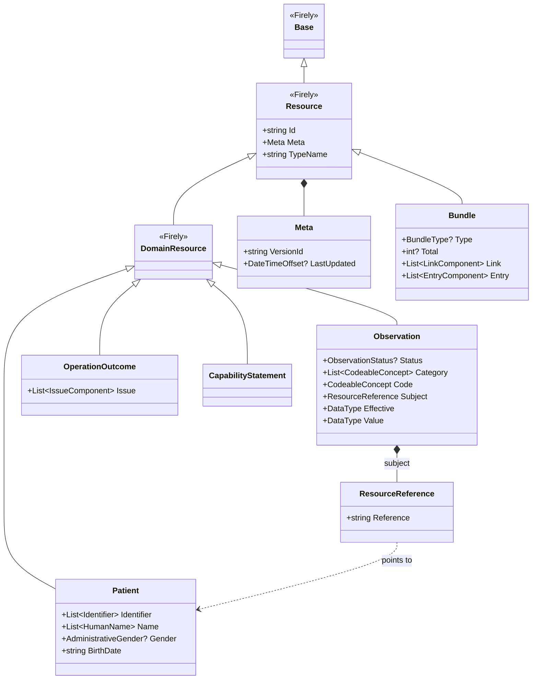

# 3. Class diagrams

Notation: `+` public, `-` private, `$` static. `Task~T~` means `Task<T>`.
Each diagram shows one folder, plus the classes it talks to directly.

## Overview: who depends on whom

Solid arrows are injected dependencies (constructor). Dotted arrows are calls to static classes.

---

## Controllers/

| Route | Action | Returns |
|---|---|---|
| `POST /{type}` | `Create` | 201 + resource |
| `GET /{type}/{id}` | `Read` | 200 + resource |
| `PUT /{type}/{id}` | `Update` | 200, or 201 if created |
| `DELETE /{type}/{id}` | `Delete` | 204 |
| `GET /{type}/{id}/_history` | `History` | 200 + Bundle(history) |
| `GET /{type}/{id}/_history/{vid}` | `VRead` | 200 + resource |
| `GET /{type}?...` | `Search` | 200 + Bundle(searchset) |
| `GET /metadata` | `MetadataController.Get` | 200 + CapabilityStatement |
| `GET /.well-known/smart-configuration` | `SmartConfigController.Get` | 200 + plain JSON |

---

## Fhir/ (FHIR plumbing)

`SupportedResources.All` is a dictionary from type name to `ResourceDefinition`. `FhirJson.ParseAs` stands for the generic `Parse<T>`.

`FhirJsonInputFormatter`, `FhirJsonOutputFormatter` and `FhirJson` all wrap the Firely SDK's
`FhirJsonDeserializer` / `FhirJsonSerializer`. FHIR JSON has rules plain System.Text.Json doesn't know, such as
`resourceType`, choice types like `effectiveDateTime`, and primitive extensions in `_field`.

---

## Data/

`UpdateAsync` returns the tuple `(Resource Resource, bool Created)` and `LoadBundleAsync` returns `(int Loaded, int Skipped)`.
Mermaid can't draw tuples, hence the made-up names above.

There's **no foreign key** between the two tables on purpose. A resource has many versions, but only the current
one has index rows, so the index points at a resource id, not at a specific version row.

---

## Search/

The same `FhirDateRange` is used on **both** sides: when indexing a stored date and when parsing a date in the
query. That's what makes "`birthdate=1984`" match a stored `1984-03-12`. See [Search engine](05-search-engine.md).

---

## Auth/

`Contexts` is nested inside `SmartScope` in the code (`SmartScope.Contexts`).

---

## The Firely model classes we use

These come from the `Hl7.Fhir.R4` NuGet package, not from this repo. Simplified.

`Observation.Effective` and `Observation.Value` are FHIR **choice types** (`effective[x]`, `value[x]`).
In JSON they show up as `effectiveDateTime` / `effectivePeriod`, `valueQuantity` / `valueString`, and so on.
