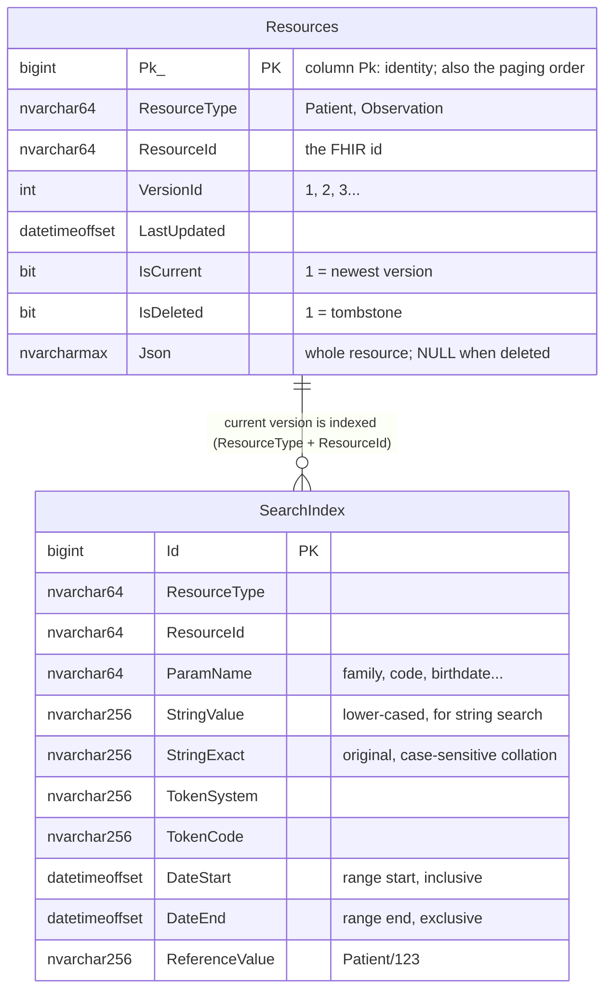
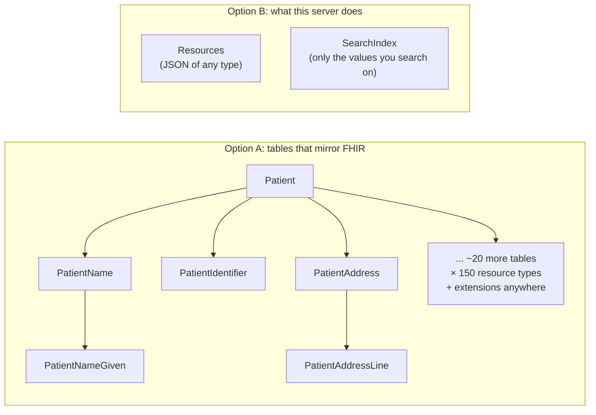
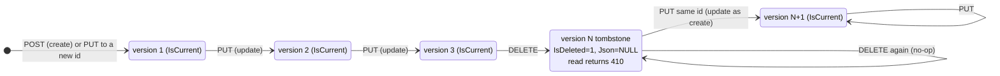
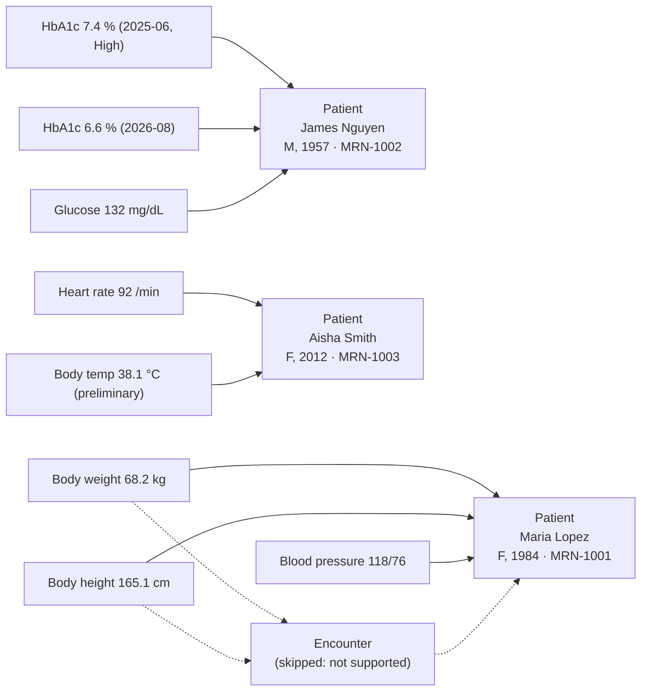

# 4. Data model

Two tables. Defined in [`Data/FhirDbContext.cs`](../src/MyFhirApi.Api/Data/FhirDbContext.cs), created by `EnsureCreated()` at startup.

## Entity-relationship diagram



**Indexes** (all non-clustered, besides the primary keys):

| Table | Columns | Purpose |
|---|---|---|
| Resources | `ResourceType, ResourceId, VersionId` (unique) | read / vread; stops two rows having the same version |
| Resources | `ResourceType, IsCurrent, IsDeleted` | the starting point of every search |
| SearchIndex | `ResourceType, ResourceId` | delete a resource's rows when it's re-indexed |
| SearchIndex | `ResourceType, ParamName, StringValue` | string search |
| SearchIndex | `ResourceType, ParamName, TokenCode` | token search |
| SearchIndex | `ResourceType, ParamName, ReferenceValue` | reference search and `_include` |

## Why "JSON blob + index" instead of a table per resource?



- FHIR resources are deep trees with optional, repeating parts and **extensions** that can appear anywhere. Option A
  needs hundreds of tables and breaks every time a profile adds an element.
- Option B stores the resource exactly as received. Only the values that search parameters need get pulled out into
  generic, typed index columns.
- Adding a resource type or search parameter means changing config (`SupportedResources`), not the database schema.
- HAPI FHIR, Microsoft FHIR Server and Firely Server all use variations of this design.

## Version lifecycle

The rows for one resource id over its life:



What the `Resources` table holds after create → update → delete:

| Pk | ResourceType | ResourceId | VersionId | IsCurrent | IsDeleted | Json |
|---|---|---|---|---|---|---|
| 41 | Patient | 123 | 1 | 0 | 0 | `{"resourceType":"Patient","id":"123","meta":{"versionId":"1"...}` |
| 42 | Patient | 123 | 2 | 0 | 0 | `{..."meta":{"versionId":"2"...}` |
| 43 | Patient | 123 | 3 | **1** | **1** | `NULL` |

Rules enforced by `ResourceRepository`:

- Exactly one row per id has `IsCurrent = 1`.
- Every write happens in a **transaction**: flip the old row's `IsCurrent`, insert the new row, replace the index rows.
  A reader never sees half an update.
- `meta.versionId` and `meta.lastUpdated` inside the JSON are always set by the server, never trusted from the client.

## What indexing produces: a real example

Sample patient **Maria Lopez** (`5f2a7c1e-...-5e01`):

```json
{
  "resourceType": "Patient",
  "identifier": [{ "system": "http://example.org/fhir/mrn", "value": "MRN-1001" }],
  "name": [{ "family": "Lopez", "given": ["Maria", "Elena"], "prefix": ["Ms."] }],
  "gender": "female",
  "birthDate": "1984-03-12"
}
```

`SearchIndexer.BuildIndex` evaluates each search parameter's FHIRPath expression and writes these rows.
This is the actual content of the `SearchIndex` table:

| ParamName | FHIRPath | StringValue | StringExact | TokenSystem | TokenCode | DateStart | DateEnd |
|---|---|---|---|---|---|---|---|
| name | `Patient.name` | lopez | Lopez | | | | |
| name | | maria | Maria | | | | |
| name | | elena | Elena | | | | |
| name | | ms. | Ms. | | | | |
| family | `Patient.name.family` | lopez | Lopez | | | | |
| given | `Patient.name.given` | maria | Maria | | | | |
| given | | elena | Elena | | | | |
| identifier | `Patient.identifier` | | | http://example.org/fhir/mrn | MRN-1001 | | |
| gender | `Patient.gender` | | | | female | | |
| birthdate | `Patient.birthDate` | | | | | 1984-03-12 00:00 | 1984-03-13 00:00 |

Things to notice:

- One FHIR element can produce **several rows**: `name` matches any part of a HumanName, including the prefix.
- `gender` is a plain code with no system in the instance, so `TokenSystem` is empty.
- The birth date is stored as a **one-day range**, because a FHIR date has day precision.

And her blood-pressure Observation:

| ParamName | FHIRPath | TokenSystem | TokenCode | DateStart | DateEnd | ReferenceValue |
|---|---|---|---|---|---|---|
| subject | `Observation.subject` | | | | | Patient/5f2a...5e01 |
| patient | `Observation.subject` (only if it's a Patient) | | | | | Patient/5f2a...5e01 |
| code | `Observation.code` | http://loinc.org | 85354-9 | | | |
| status | `Observation.status` | | final | | | |
| category | `Observation.category` | http://terminology.hl7.org/CodeSystem/observation-category | vital-signs | | | |
| date | `Observation.effective` | | | 2026-09-15 09:06:00 | 2026-09-15 09:06:01 | |

The systolic/diastolic codes inside `Observation.component` are **not** indexed under `code`.
That's correct per the spec: R4 has a separate `component-code` parameter, which this prototype doesn't implement.

## The sample data



Arrows are `Observation.subject` references. Dotted arrows are `Observation.encounter` references to the skipped
Encounter. Those references stay in the JSON, but nothing validates them, because only `subject` is checked.
