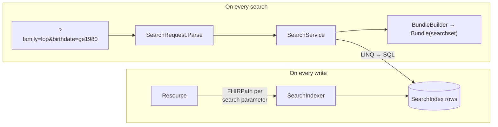
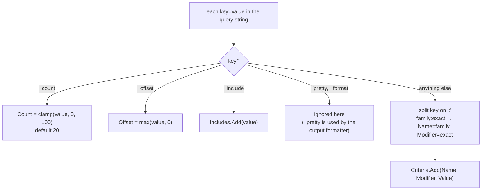
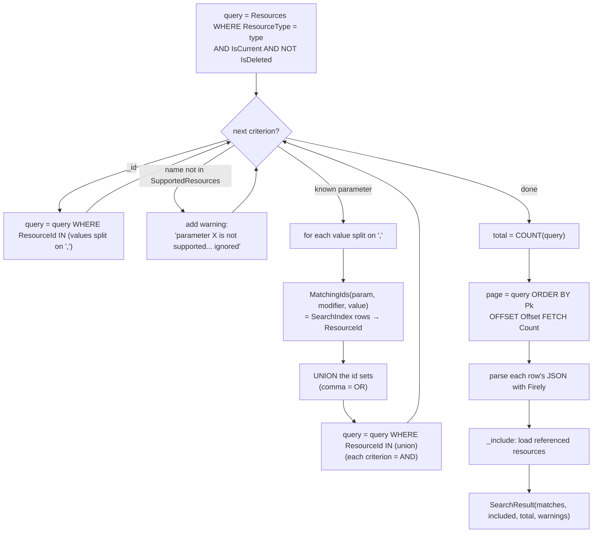
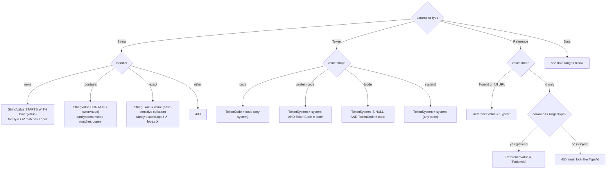
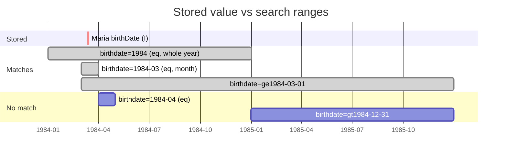
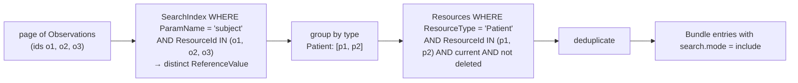
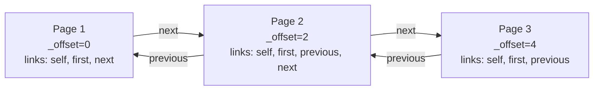

# 5. Search engine

Search happens in two halves, and they mirror each other:



Searching never opens the JSON. It only looks at index rows, then loads the JSON of the matching page.

## 1. Parsing the query string — [`SearchRequest.cs`](../src/MyFhirApi.Api/Search/SearchRequest.cs)



Example: `GET /Patient?family:exact=Lopez&birthdate=ge1980&birthdate=lt1990&_count=5`

| Criteria | Name | Modifier | Value |
|---|---|---|---|
| 1 | family | exact | Lopez |
| 2 | birthdate | | ge1980 |
| 3 | birthdate | | lt1990 |

Count = 5, Offset = 0, Includes = []

## 2. Building the query — [`SearchService.cs`](../src/MyFhirApi.Api/Search/SearchService.cs)



**AND vs OR in one picture:**

```text
GET /Patient?family=smith,jones&gender=female

   ┌───────── criterion 1 (OR) ─────────┐     ┌─ criterion 2 ─┐
   (family starts with "smith"  UNION   family starts with "jones")   AND   (gender = female)
```

The generated SQL has this shape (simplified):

```sql
SELECT COUNT(*) FROM Resources r
WHERE r.ResourceType = 'Patient' AND r.IsCurrent = 1 AND r.IsDeleted = 0
  AND r.ResourceId IN (
        SELECT ResourceId FROM SearchIndex WHERE ResourceType='Patient' AND ParamName='family' AND StringValue LIKE 'smith%'
        UNION
        SELECT ResourceId FROM SearchIndex WHERE ResourceType='Patient' AND ParamName='family' AND StringValue LIKE 'jones%')
  AND r.ResourceId IN (
        SELECT ResourceId FROM SearchIndex WHERE ResourceType='Patient' AND ParamName='gender' AND TokenCode = 'female')
```

To see the real SQL, set `"Microsoft.EntityFrameworkCore.Database.Command": "Information"` under `Logging:LogLevel`
in `appsettings.Development.json`.

## 3. Matching rules per parameter type



Modifiers on token, date or reference parameters return 400 (only string modifiers are implemented).

## 4. Date ranges — [`FhirDateRange.cs`](../src/MyFhirApi.Api/Search/FhirDateRange.cs)

Every date, whether stored or searched, becomes a half-open range `[Start, End)` based on its **precision**:

| Written as | Precision | Start | End (exclusive) |
|---|---|---|---|
| `1984` | year | 1984-01-01 | 1985-01-01 |
| `1984-03` | month | 1984-03-01 | 1984-04-01 |
| `1984-03-12` | day | 1984-03-12 | 1984-03-13 |
| `2026-09-15T09:06:00Z` | second | 09:06:00 | 09:06:01 |
| Period `{start: A}` (no end) | | A | 9999-12-31 (open-ended) |

A time without a time zone is treated as UTC.

The search prefix decides how the stored range **I** (index) must relate to the search range **P** (parameter):

| Prefix | Meaning | Condition in code |
|---|---|---|
| `eq` (default) | I lies entirely inside P | `I.Start >= P.Start AND I.End <= P.End` |
| `ne` | not entirely inside | `I.Start < P.Start OR I.End > P.End` |
| `gt` | some of I is after P | `I.End > P.End` |
| `lt` | some of I is before P | `I.Start < P.Start` |
| `ge` | some of I is at or after P's start | `I.End > P.Start` |
| `le` | some of I is at or before P's end | `I.Start < P.End` |

Worked example: Maria's birth date is stored as **I = [1984-03-12, 1984-03-13)**.



- `birthdate=1984` matches: the one-day range sits entirely inside the year.
- `birthdate=1984-04` doesn't match: I isn't inside April.
- `birthdate=gt1984-12-31` doesn't match: no part of I is after Dec 31.

## 5. `_include`



Only `Observation:subject` and `Observation:patient` are allowed (`ResourceDefinition.Includes`).
Anything else is ignored with a warning. Included resources don't count toward `total` or `_count`.

## 6. Paging and the response Bundle — [`BundleBuilder.cs`](../src/MyFhirApi.Api/Search/BundleBuilder.cs)

Example: total = 5, `_count = 2`.



- Results are ordered by `Pk` (insertion order), so pages don't overlap or skip items.
  Paging by offset can still shift if data changes between page requests. Production servers often use continuation
  tokens instead.
- Clients should **follow the links** rather than build page URLs themselves.

A searchset Bundle has this shape:

```text
Bundle (type = searchset, total = 5)
├── link: self / first / previous / next
├── entry  search.mode = match     fullUrl = http://host/Observation/o1    resource = Observation
├── entry  search.mode = match     ...
├── entry  search.mode = include   fullUrl = http://host/Patient/p1        resource = Patient
└── entry  search.mode = outcome   resource = OperationOutcome (warnings, only if any)
```

## Known limitations

| Not implemented | What a production server does |
|---|---|
| `_sort` | order by index values |
| `_revinclude`, chained parameters (`subject:Patient.name=x`) | joins through reference index rows |
| number, quantity, uri, composite types; `component-code` | more index columns, unit conversion (UCUM) for quantities |
| `:missing`, `:not`, `:text`, `:above`/`:below` modifiers | extra predicates, terminology lookups |
| Reindexing after search parameters change | a background `$reindex` job |
| `Prefer: handling=strict` | 400 for unknown parameters instead of a warning |
