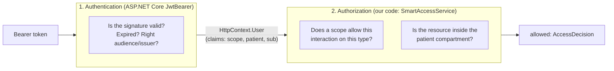
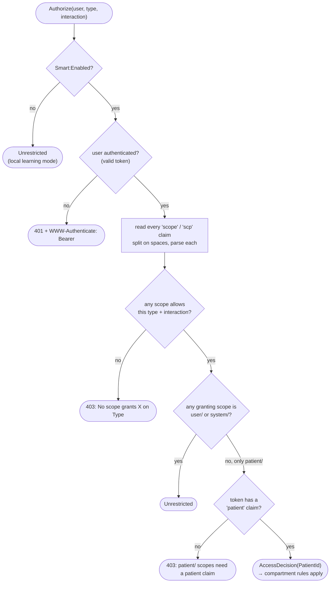
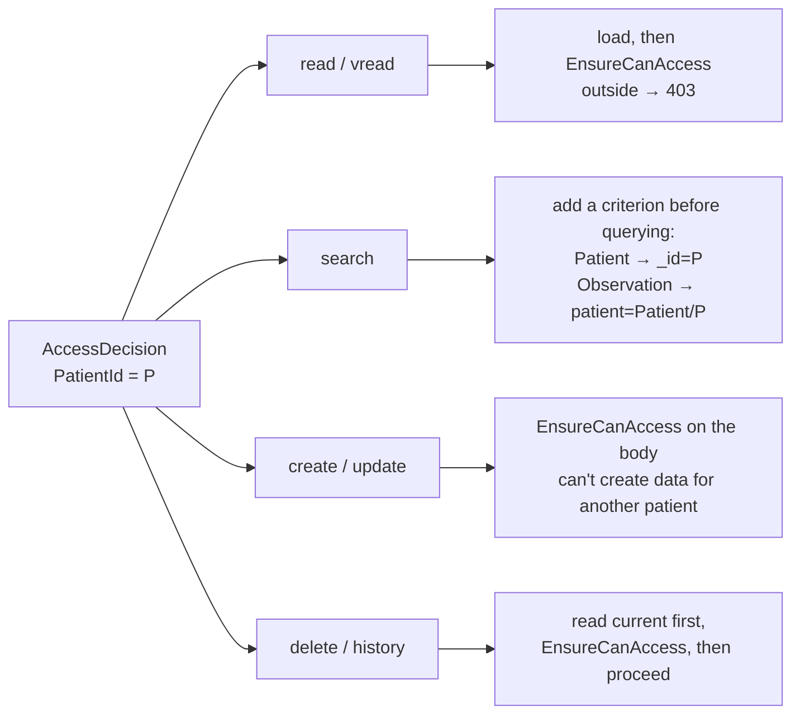

# 6. Security: SMART on FHIR

Code: [`Auth/`](../src/MyFhirApi.Api/Auth). Configuration: `Smart:Enabled` (off in Development, on everywhere else).

## Two separate jobs



JwtBearer never rejects a request by itself, because no endpoint has `[Authorize]`. It only fills in `User`.
Our code decides, so every denial comes back as a FHIR `OperationOutcome`.

## Scope syntax

```text
 patient / Observation . rs ? category=laboratory
 ───┬───   ─────┬─────   ─┬   ──────────┬─────────
    │           │         │             └─ v2 filter (ignored in this prototype → grants a bit more)
    │           │         └─ permissions: v1 read | write | *   or   v2 any of c r u d s
    │           └─ resource type, or * for all
    └─ context: patient (one patient) | user (what the user may see) | system (backend service)
```

How permissions map to interactions (`SmartScope.TryParse` + `Allows`):

| Permission | c (create) | r (read, vread, history) | u (update) | d (delete) | s (search) |
|---|:-:|:-:|:-:|:-:|:-:|
| v1 `read` | | ✔ | | | ✔ |
| v1 `write` | ✔ | | ✔ | ✔ | |
| v1 `*` | ✔ | ✔ | ✔ | ✔ | ✔ |
| v2 `rs` | | ✔ | | | ✔ |
| v2 `cruds` | ✔ | ✔ | ✔ | ✔ | ✔ |

Non-resource scopes like `openid`, `fhirUser`, `launch/patient` and `offline_access` are ignored here. They matter to
the authorization server, not to the API.

## The authorization decision — `SmartAccessService.Authorize`



## What a restricted (patient) decision does per interaction



The patient compartment rules ([`PatientCompartment.cs`](../src/MyFhirApi.Api/Auth/PatientCompartment.cs)):

| Resource | Belongs to patient P when |
|---|---|
| Patient | `id == P` |
| Observation | `subject.reference == "Patient/P"` |

The full R4 definition lists which fields link each resource type to a patient:
https://hl7.org/fhir/R4/compartmentdefinition-patient.html

## Outcomes with real tokens

What you get with the three tokens from the earlier demo:

| Request | no token | `user/*.cruds` | `user/Patient.read` | `patient/*.rs` (James) |
|---|---|---|---|---|
| `GET /metadata` | 200 | 200 | 200 | 200 |
| `GET /Patient` | 401 | 200 (all) | 200 (all) | 200 (only James) |
| `GET /Patient/{maria}` | 401 | 200 | 200 | **403** |
| `POST /Patient` | 401 | 201 | **403** | **403** (no `c`) |
| `GET /Observation` | 401 | 200 (all) | **403** (wrong type) | 200 (only James's 3) |

## Public endpoints

`GET /metadata` and `GET /.well-known/smart-configuration` never check tokens. Apps call them **before**
they have a token, to find out how to get one.

## From prototype to production

| Here | Production |
|---|---|
| `dotnet user-jwts` signs tokens with a local key from user secrets | A real authorization server; set `Authentication:Schemes:Bearer:Authority` so JwtBearer downloads its signing keys |
| `Smart:AuthorizeEndpoint` / `TokenEndpoint` are placeholders | The authorization server's real URLs (advertised in `/metadata` and SMART discovery) |
| v2 scope filters (`?category=...`) ignored | Apply them as extra search criteria |
| Compartment rules for 2 types | The full patient CompartmentDefinition |
| No audit trail | `AuditEvent` per access (HIPAA) |
