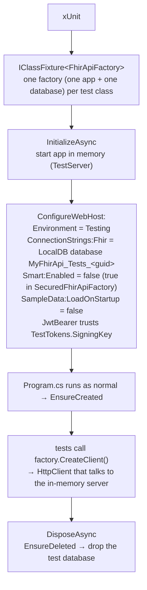
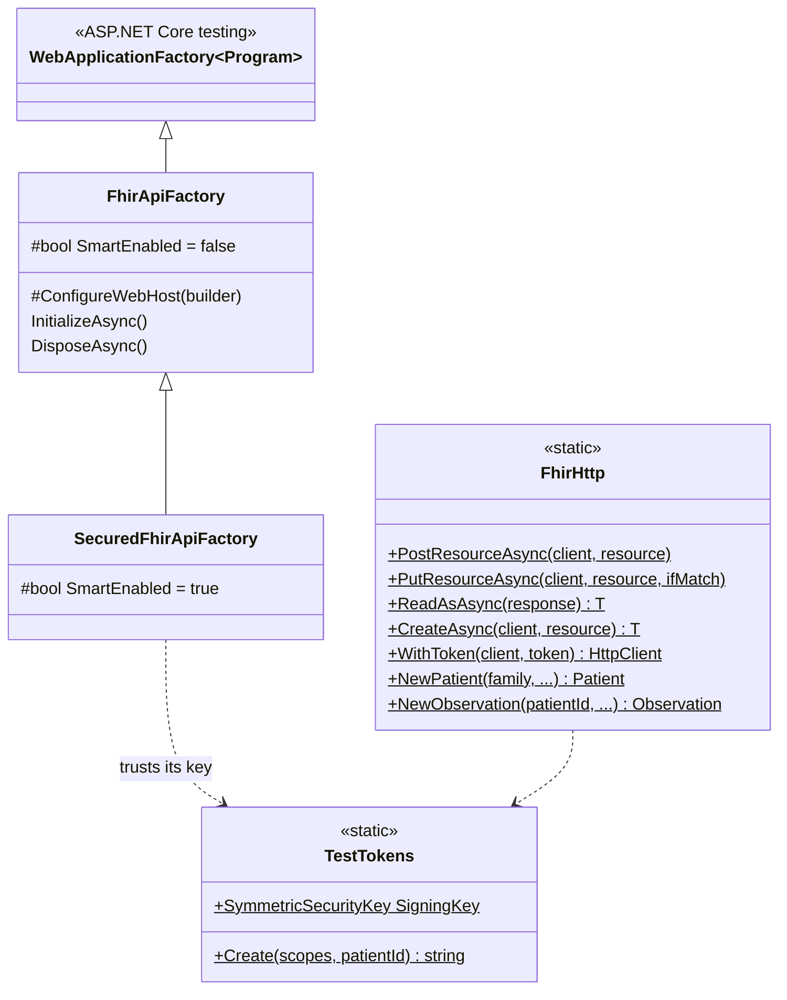
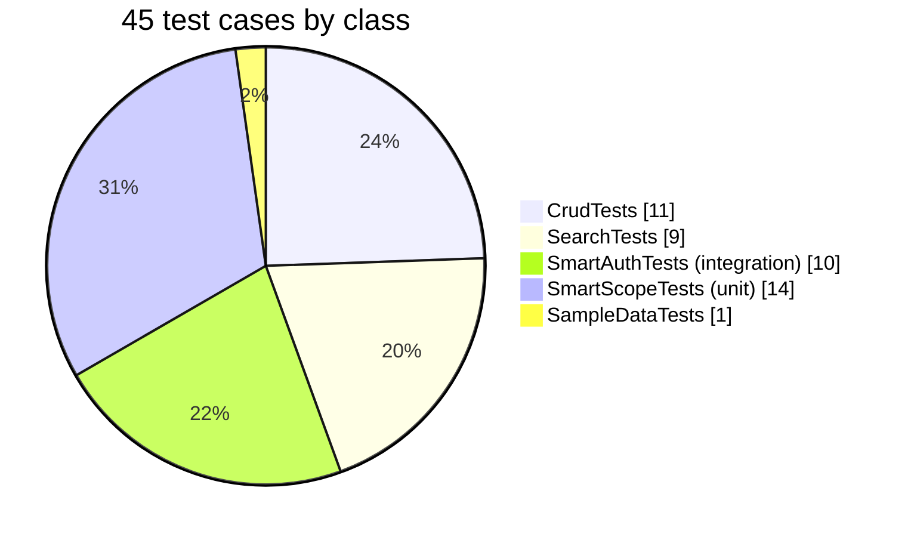

# 7. Testing

All tests are **integration tests**: they run the real app in memory and send real HTTP requests to it. The only
exception is `SmartScopeTests`, which unit-tests scope parsing. Run them with `dotnet test`. The app doesn't need to be running.

## How a test run is wired





Why `public partial class Program;` is at the bottom of `Program.cs`: it lets `WebApplicationFactory<Program>` find
the app's entry point from the test project.

## What's covered



(Each `[InlineData]` row of a `[Theory]` counts as one test case.)

| Class | Factory | Covers |
|---|---|---|
| `CrudTests` | `FhirApiFactory` | `/metadata`; create (server-assigned id, ETag, Location); read; update + `If-Match` → 412; PUT creates; delete → 410; history order; vread; invalid FHIR → 400; malformed JSON → 400; body type mismatch; dangling Observation subject; unsupported type → 404 |
| `SearchTests` | `FhirApiFactory` | string prefix, `:exact`, `:contains`; comma OR and parameter AND; token with/without system; date precision and prefixes; reference + `_include`; paging links; deleted resources excluded; unknown parameter warning |
| `SmartAuthTests` | `SecuredFhirApiFactory` | public endpoints; 401 without token; 403 for read-only and wrong-type scopes; permissions checked **before** body validation (also for malformed JSON); user scope full access; patient scope sees only its own data; patient scope without patient claim |
| `SmartScopeTests` | none (unit) | v1/v2 permission parsing, wildcard types, `?filter` suffix, rejecting non-resource scopes |
| `SampleDataTests` | `FhirApiFactory` | loading the bundled file: 11 loaded, 1 skipped, `urn:uuid` references rewritten |

## Keeping tests independent

Tests in a class share one database, so each test makes its data unique:

```csharp
private static string Unique(string prefix) => $"{prefix}{Guid.NewGuid():N}"[..20];

var family = Unique("Date");                       // e.g. "Date3f9a1c2b7e4d5f6a"
await _client.CreateAsync(NewPatient(family, birthDate: "1975-06-15"));
Assert.Equal(1, (await SearchAsync($"Patient?family={family}&birthdate=1975")).Total);
```

Filtering by the unique family name means other tests' patients never affect the counts.

## Writing a new test

```csharp
public sealed class MyNewTests(FhirApiFactory factory) : IClassFixture<FhirApiFactory>
{
    private readonly HttpClient _client = factory.CreateClient();

    [Fact]
    public async Task Something_works()
    {
        var patient = await _client.CreateAsync(NewPatient("Unique123"));    // arrange

        var response = await _client.GetAsync($"Patient/{patient.Id}");      // act

        Assert.Equal(HttpStatusCode.OK, response.StatusCode);                 // assert
    }
}
```

Use `SecuredFhirApiFactory` and `client.WithToken(TestTokens.Create("user/*.rs"))` when the test needs access checks on.
