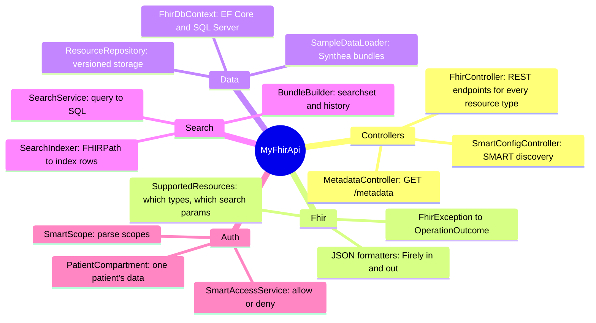
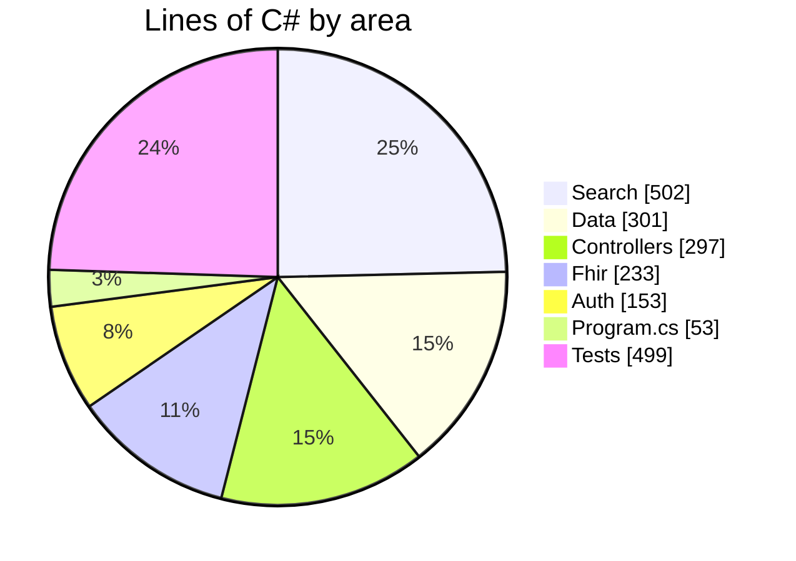

# MyFhirApi: developer docs

Diagrams and explanations of how this FHIR server works inside. The diagrams are written in
[Mermaid](https://mermaid.js.org/), which GitHub, Rider (Markdown preview) and VS Code render automatically.

New to FHIR? Read the [project README](../README.md) first for the concepts, then come here for the internals.

## Reading order

| # | Doc | What you'll learn |
|---|---|---|
| 1 | [Architecture](01-architecture.md) | The big picture: layers, components, the ASP.NET Core pipeline, startup, dependency injection |
| 2 | [Request flows](02-request-flows.md) | Sequence diagrams for create, read, update (with conflict), delete/history, search, errors, startup, and the SMART login |
| 3 | [Class diagrams](03-class-diagrams.md) | Every class and how they relate, grouped by folder |
| 4 | [Data model](04-data-model.md) | The two database tables, how versions work (state diagram), and what the search index looks like for a real patient |
| 5 | [Search engine](05-search-engine.md) | How a query string becomes SQL: parsing, matching per parameter type, date ranges, `_include`, paging |
| 6 | [Security (SMART on FHIR)](06-security-smart.md) | Scopes, the authorization decision tree, and patient compartments |
| 7 | [Testing](07-testing.md) | How the integration tests are wired and what each test class covers |

## The codebase at a glance

## Where the code is (lines of C#)

Search is the biggest area. That's normal for a FHIR server: storing and reading resources is simple, but FHIR search has
many parameter types, modifiers and result options.
